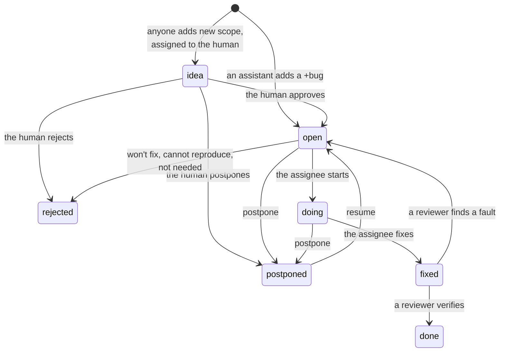

## taskwarrior-squire

Frustrated with a 1.4 MB `TODO.md` whose longest line ran to 66 KB, I wrote squire, a [taskwarrior](https://taskwarrior.org) extension, so that one human and their AI assistants work from one task list: the assistants pick work and ask questions there, and new scope waits for the human.

### What it adds to taskwarrior

- **A flow.** `state` is `idea`, `open`, `doing`, `fixed`, `done`, `postponed` or `rejected`. Only the human approves an idea. An assistant files a discrepancy as a `+bug` and works it through `open → doing → fixed → done`; the hook refuses a skipped step.
- **A definition of done.** A task in `open` or `doing` says `DONE WHEN:` in its body or a comment, so whoever verifies it knows what to check.
- **Assignee.** `assignee` says who acts next: the human or an assistant.
- **Hand-offs.** When an assistant needs the human for a question, an approval, a manual test or a push to production, it comments what it needs and assigns the task to the human. The human answers in a comment and assigns the task back.
- **`task mine`.** The live, unblocked tasks assigned to whoever runs it, by version and then by urgency, each with the question on top. For an assistant, it is the work queue.
- **`task board`.** Every live task on one line: UUID, state, assignee, priority, version, ref, tags, title.
- **Authors.** Every task, change and comment records who made it.
- **Hygiene.** A title is at most 80 characters, a body 800, a comment 500, for everyone. A tag starts with a letter.
- **A skill** that teaches an assistant all of the above.

Everything else (dependencies, priorities, tags, urgency, search, history, undo) is plain taskwarrior.

### Why

The flow comes from a project where assistants found and fixed about two thousand discrepancies, and asked the human only about the rest. It outgrew the markdown files it started in.

- Priorities survive when the assistant's context is cleared. They live in the database, not in its head.
- No task disappears without a trace. In a markdown file, an edit can drop a row and nobody notices. Here a task ends only as `done` or `rejected`, and its history stays.
- The assistant asks a question by assigning the task to the human, and keeps working on something else.
- New scope starts only when the human approves it. A bug goes straight to work.
- No task grows into an essay. Long text is refused at the door.

### Install

    brew install pirj/tap/taskwarrior-squire

Then, in the project:

    squire init

It prints `TASKRC` and `TASKDATA`: set them for the project directory with whatever sets your per-directory environment (mise, direnv, …). For Claude Code it also writes into `.claude/settings.json` the env and a hook that gives every session and subagent the installed skill at its start, and, in `.claude/skills/`, a skill that reads the installed one, so upgrades reach the assistant. Your `~/.taskrc` still applies; the squire taskrc includes it. The database, `taskchampion.sqlite3`, appears in the `TASKDATA` directory on first use.

### Flow

`done` and `rejected` close the task; another state opens it again.

The human is `$USER`. An assistant sets `SQUIRE_AUTHOR` to its own name.

### Cheat sheet

The human:

    task add "Add rubocop to the demos" state:open priority:H version:0.5 assignee:claude "body:DONE WHEN: bin/lint runs rubocop on every demo"
    task mine
    task 9c1e0f2a annotate "B: only the default cops" && task 9c1e0f2a modify assignee:claude
    task 77ab31d0 modify state:open
    task state:idea board

The assistant:

    task mine
    task board
    task 469e1a60 modify state:doing
    task 469e1a60 annotate "Added to all demos in 3f2a1c9"
    task 469e1a60 modify state:fixed
    task 469e1a60 done
    task 5d0e4b17 annotate "Cannot reproduce on main" && task 5d0e4b17 modify state:rejected
    task 77ab31d0 modify depends:469e1a60
    task 469e1a60 info

Use the UUID prefix in references; taskwarrior renumbers its short numeric IDs. All of it: `man taskwarrior-squire`.

### Assistants

The assistant needs three variables: `TASKRC`, `TASKDATA`, and `SQUIRE_AUTHOR` set to its name (`claude`, `codex`, anything). `squire init` writes them for Claude Code. For another assistant, put them in its environment, and point it at the skill: `$(brew --prefix)/share/taskwarrior-squire/SKILL.md`, or tell it in `AGENTS.md` to read `man taskwarrior-squire`.

### Architecture

The taskrc declares the fields, the hooks directory, and `mine` as an `execute` alias. The rules are one hook in Python. `squire init` only writes the environment; after that, there is no squire binary between you and `task`.

If the database sits in a git-tracked directory, you choose whether to commit it or to ignore it. It is a binary file: git shows no diff for it.

Tests: `make test`.

### Why not

- **taskwarrior alone**: no flow and no limits. A comment has no author, so an assistant that uses the human's account writes as the human.
- **[beads](https://github.com/gastownhall/beads)**: `bd init` wrote 19 files into the repository, among them other assistants' configs and five git hooks. It also tells your assistant to stop using its own memory.
- **[Backlog.md](https://github.com/MrLesk/Backlog.md)**: markdown files again. We are escaping from those.
- **[git-bug](https://github.com/git-bug/git-bug)**: open or closed, and nothing in between.
- **GitHub Issues**: needs the network, and the assistant writes with the human's token, so every author is the human.
- **Jira**: no.
- **[DoltLite](https://www.dolthub.com/blog/2026-03-25-doltlite/)** as the storage, not yet: it is a SQLite with commits and merges, and TaskChampion's storage is pluggable. Two branches would then merge their tasks.

### License

taskwarrior-squire is written by Phil Pirozhkov and released under the [MIT License](https://opensource.org/licenses/MIT).
